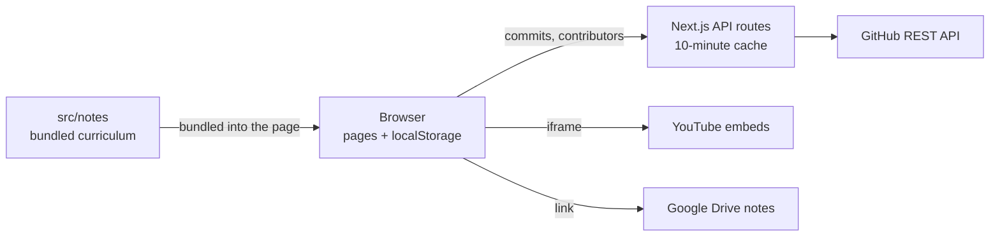

# Notes-Aid Technical Overview

Notes-Aid is a Next.js web app that lets engineering students browse notes and lecture videos by year, branch and semester. It has no database: curriculum content ships as TypeScript files, and each student's progress stays in their own browser. The only server code is two small routes that read from GitHub.

| Layer | Technology |
| --- | --- |
| Framework | Next.js 15 (App Router), React 19, TypeScript |
| Styling | Tailwind CSS 4, daisyUI 5 |
| Curriculum content | Static TypeScript files in `src/notes/` (109 files) |
| Student progress | Browser `localStorage` |
| External services | GitHub REST API, YouTube embeds, Google Drive links |
| Analytics | Google Analytics, Microsoft Clarity |



## Routing

Routing uses the Next.js App Router, so each `page.tsx` or `route.ts` under `src/app/` is a URL. There is no middleware and no authentication.

| URL | File | Purpose |
| --- | --- | --- |
| `/` | `src/app/page.tsx` | Form to choose branch, year and semester |
| `/[year]/[branch]/[semester]` | `src/app/[year]/[branch]/[semester]/page.tsx` | Subjects, modules, topics and videos |
| `/contributors` | `src/app/contributors/page.tsx` | Contributor cards; no longer linked from the UI |
| `/api/github-commits` | `src/app/api/github-commits/route.ts` | Commits used for notifications |
| `/api/github-contributors` | `src/app/api/github-contributors/route.ts` | Contributor list |

Valid URL values:

- **Year:** `fy`, `sy`, `ty`, `ly`
- **Branch:** `comps`, `mech`, `excp`, `it`, `extc`, `rai`, `cce`, `csbs`, `aids`
- **Semester:** `odd`, `even`

How a curriculum URL resolves:

1. The page reads `year`, `branch` and `semester` with `useParams`.
2. It looks up `NotesData[year]?.[branch]?.[semester]` in `src/notes/data.tsx`.
3. It loads the year's syllabus and past-paper links from `src/notes/pyq.tsx`.
4. If no subjects are found, it shows "No Subjects Found". The HTTP status is still 200.

34 of the 72 possible combinations currently have subjects. First year is common to all branches: `comps` and `aids` use one semester order, and the other seven branches have the two semesters swapped.

## Database

There is no database. Content is compiled into the app, so changing it means editing a file and redeploying.

Curriculum files follow this layout:

```text
src/notes/
├── data.tsx                       Index: year > branch > semester
├── pyq.tsx                        Syllabus and past-paper links by year
└── sy/comps/oddSem/
    ├── subject.tsx                Lists the semester's subjects
    └── dsm/data.tsx               One subject's content
```

Each subject has this shape, defined in `src/interfaces/Subject.tsx`:

```text
Subject
├── name, icon, color
└── modules { 1, 2, ... }
    ├── notesLink[]  { title, url }
    └── topics[]     { title, description }
        ├── videos[] { title, url? }
        └── notes[]  { title, url }
```

Browser `localStorage` holds everything specific to a student:

| Key | Contents |
| --- | --- |
| `<subjectKey>-progress` | Completed videos, plus module, topic and subject counts |
| `selectedBranch`, `selectedYear`, `selectedSemester` | Last selection, for "Return to Previous Selection" |
| `theme` | The theme the student chose |
| `LastNotificationRead` | Time notifications were last marked as read |

Progress never leaves the device, so it doesn't sync between devices. It is keyed by subject key alone, so two branches using the same key (for example `dsm`) share progress.

## Backend

The backend is two read-only GET routes. Both call `fetchFromRepo` in `src/lib/github.ts`, which requests data from `aziatashi/student-notes-portal` on GitHub.

| Route | GitHub endpoint | Returns | On failure |
| --- | --- | --- | --- |
| `/api/github-commits` | `commits` | `{ id, message, date, read }[]` | 500 with an error message |
| `/api/github-contributors` | `contributors` | GitHub's contributor list | 500 with an error message |

- **Caching:** responses are cached for 10 minutes and shared between visitors, so traffic doesn't multiply GitHub calls.
- **Rate limit:** GitHub allows 60 calls an hour per IP without a token, and 5,000 with one.

Environment variables read by the code:

| Variable | Required | Purpose |
| --- | --- | --- |
| `GITHUB_TOKEN` | No | Raises the GitHub rate limit; server only |
| `NEXT_PUBLIC_GOOGLE_ANALYTICS` | No | Google Analytics ID |
| `NEXT_PUBLIC_MICROSOFT_CLARITY` | No | Microsoft Clarity ID |

The local `.env` also has values such as `MONGODB_URI`, `REDIS_URL` and the Firebase and OAuth keys. Nothing in `src/` reads them; they were copied from the removed v2 app.

## Main functions

| Function | File | What it does |
| --- | --- | --- |
| `fetchFromRepo` | `src/lib/github.ts` | Fetches a repository endpoint with caching and the optional token; throws on a non-OK response |
| `GET` (commits) | `src/app/api/github-commits/route.ts` | Converts commits into notification objects |
| `GET` (contributors) | `src/app/api/github-contributors/route.ts` | Returns the contributor list |
| `useProgress` | `src/hook/useProgress.tsx` | Loads a subject's progress and exposes `progressData`, `updateVideoProgress` and `resetProgress` |
| `updateVideoProgress` | `src/hook/useProgress.tsx` | Toggles a video, updates the counts and saves to `localStorage` |
| `resetProgress` | `src/hook/useProgress.tsx` | Clears one subject's progress |
| `handleContinue` | `src/app/page.tsx` | Saves the selection and opens the curriculum page |
| `handleReturnToPrevious` | `src/app/page.tsx` | Reopens the last saved selection |
| `numberVideoInModule` | `src/app/[year]/[branch]/[semester]/page.tsx` | Counts the videos in a module |
| `toggleTopic` | `src/components/TopicList.tsx` | Opens or closes one topic |
| `toggleVideo` | `src/components/VideoAccordion.tsx` | Stops the playing video and opens or closes a row |
| `fetchNotifications` | `src/components/Navbar.tsx` | Loads commits, keeps those starting with `notify:` and counts unread ones |
| `markAllAsRead` | `src/components/Navbar.tsx` | Records the read time and clears the badge |

Any commit whose message starts with `notify:` appears as a site notification, as long as it is among the 30 most recent commits.

## Main frontend

All pages share `src/app/layout.tsx`, which sets the theme and renders the navbar, the page and the analytics scripts. The curriculum page is the core of the UI:

```text
RootLayout
├── Navbar
│   └── Notifications dropdown
├── EngineeringCurriculum (curriculum page)
│   ├── Subject cards
│   ├── Important links and ModuleCard list
│   │   └── ProgressBar
│   └── TopicList
│       ├── Notes links
│       └── VideoAccordion
│           └── Video (tick box and YouTube iframe)
└── Metrics
```

| Component | Role |
| --- | --- |
| `Navbar` | Home link and notifications |
| `ModuleCard` | Shows a module's topic count and video progress |
| `TopicList` | Shows study materials and expandable topics |
| `VideoAccordion` | Keeps one video open at a time |
| `Video` | Renders the tick box, title and YouTube player |
| `ProgressBar` | Draws completion as a percentage bar |
| `Metrics` | Loads Google Analytics and Microsoft Clarity |

**Theming:** Evergreen is the only theme, defined in `src/app/globals.css` and set on `<html>` in `layout.tsx`. Components should use theme colours such as `bg-base-100` and `text-primary`.

## Adding content

1. Add or edit `src/notes/<year>/<branch>/<semester>Sem/<subject>/data.tsx`.
2. List the subject in that semester's `subject.tsx`.
3. For a new branch or semester, import it in `src/notes/data.tsx` and add it to `NotesData`.

Video URLs must be YouTube embed URLs, such as `https://www.youtube.com/embed/<id>`.
